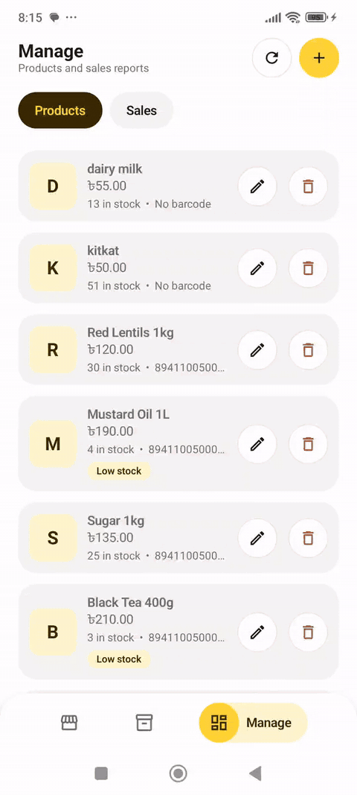
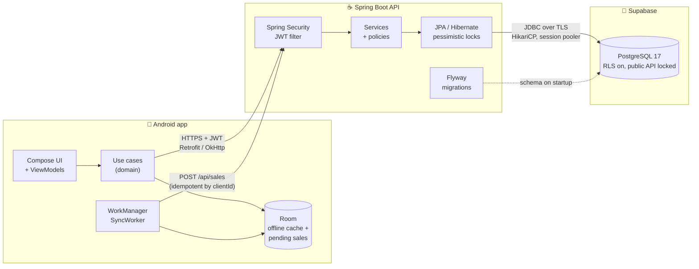
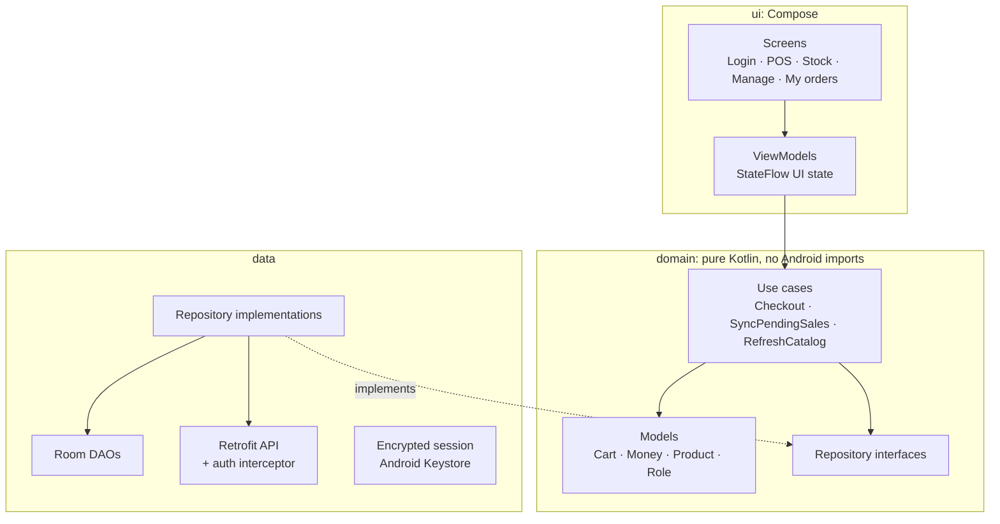
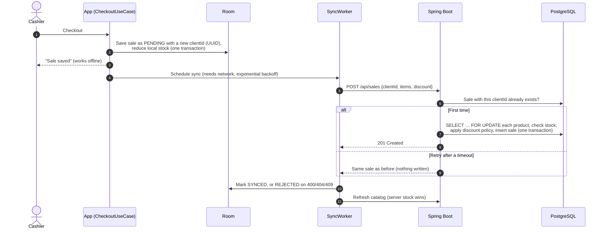
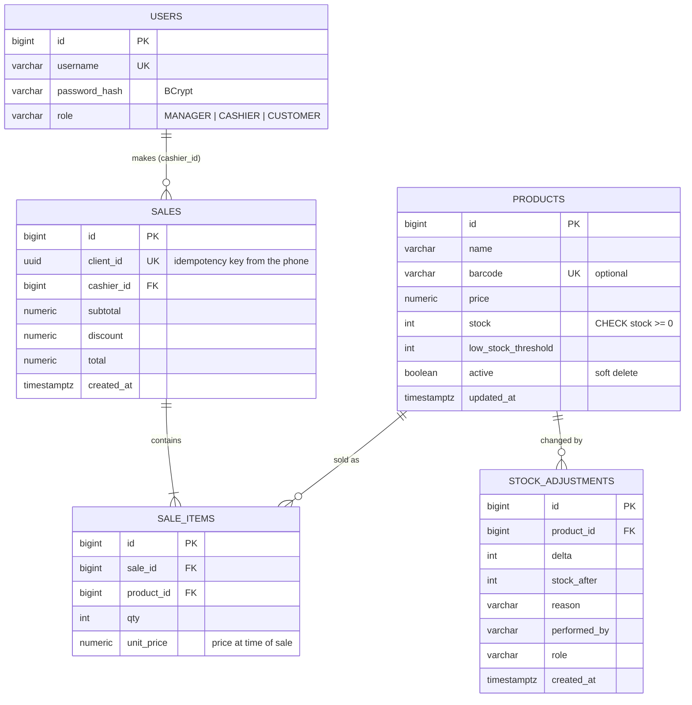

# Smart Inventory POS

**An offline-first point-of-sale and inventory system for small shops.**
Android (Kotlin, Jetpack Compose) on the counter, a Spring Boot API behind it, PostgreSQL on Supabase.
Sales keep working when the internet doesn't, and sync without ever being counted twice.


<p align="center">
  
</p>
<p align="center">
  <i>Recorded on a real phone (Xiaomi, Android 13) against the real backend and Supabase database.</i><br>
  <a href="docs/media/demo.mp4"><b>▶ Watch the full 2.5-minute demo</b></a>: manager, cashier and customer flows.
</p>

---

## Contents

- [What it does](#what-it-does)
- [Architecture](#architecture)
- [Data model](#data-model)
- [Engineering decisions](#engineering-decisions)
- [Tech stack](#tech-stack)
- [Project structure](#project-structure)
- [Run it locally](#run-it-locally)
- [Testing](#testing)
- [API](#api)
- [Security](#security)
- [Known limitations and roadmap](#known-limitations-and-roadmap)

## What it does

One app, three roles. The server decides what each role may do; the app only reflects it.

| | Manager | Cashier | Customer |
|---|:---:|:---:|:---:|
| Sell, search by name or barcode | ✅ | ✅ | ✅ (self-checkout) |
| Give a discount | ✅ | ✅ | ❌ always ৳0 |
| Adjust stock | ✅ any amount | ✅ up to ±20 per change | ❌ |
| Add, edit, deactivate products | ✅ | ❌ | ❌ |
| Low-stock list | ✅ | ✅ | ❌ |
| Sales history, today's revenue | ✅ all sales | ❌ | own orders only |

Anyone can sign up, and a public sign-up always creates a **customer**. Staff accounts are created by the system, never through the app.

## Architecture

### System



The phone never talks to the database. Every rule (prices, discounts, stock limits, who may do what) is enforced by the API, so a modified app can't bypass it.

### Android app: clean architecture



Dependencies point inward. The domain layer has no Android or framework code, so the business rules (cart maths, discount checks, sync decisions) are unit-tested on the JVM in milliseconds. Hilt wires the layers together.

### Offline-first checkout

The core flow: a sale is saved on the phone first, then uploaded. Losing the network mid-sale can't lose the sale or charge it twice.



## Data model

Five tables, created and versioned by Flyway (`backend/src/main/resources/db/migration`). Hibernate only validates them at startup and never changes the schema.



`sale_items.unit_price` copies the price at the moment of sale, so changing a product's price later never rewrites past sales. `stock_adjustments` is an append-only audit log: who changed stock, by how much, and why.

## Engineering decisions

The trade-offs worth talking about, and why I made them.

**1. Idempotent checkout instead of "hope the network works."**
The phone generates a UUID (`clientId`) per sale, and the database has a unique constraint on it. If an upload times out after the server already saved the sale, the retry returns the saved sale instead of creating a second one. This is what makes automatic background retries safe.

**2. Pessimistic row locks for stock.**
Two cashiers selling the last item at the same moment must not both succeed. `SaleService` locks each product row (`SELECT … FOR UPDATE`) inside the sale transaction, and a `CHECK (stock >= 0)` constraint is the last line of defence. Overselling returns `409 Conflict`. Optimistic locking would have meant retry loops on the hottest rows; with a handful of tills, a short lock is simpler and correct.

**3. The server is the source of truth; the phone is a cache.**
The app reduces stock locally so the screen is right while offline, then refreshes from the server after every sync. A sale the server rejects (for example, out of stock) is marked `REJECTED`, shown to the user, and its local stock change is undone by the next refresh. No merge logic, no conflicts to resolve by hand.

**4. Business rules as small, swappable policies.**
Discounts and stock limits live in `DiscountPolicy` and `StockAdjustmentPolicy`: single-method interfaces with one role-based implementation each. New rules (a discount cap, a loyalty discount) become a new class, not edits scattered through services. Both are unit-tested in isolation.

**5. Kept Spring Boot when moving to Supabase.**
Supabase can expose the database straight to the app (REST and row-level security), which would remove the backend entirely. I rejected that: the stock locking, idempotency and role rules would have to be rewritten as SQL functions and RLS policies. Instead only the database moved. A Flyway callback (`afterMigrate.sql`) turns on RLS and revokes Supabase's public roles on every table, so the auto-generated REST API can't read `users.password_hash`.

**6. Connection handling for a hosted database.**
The Supabase pooler and home routers silently drop idle connections after about 2 minutes, which showed up as random "cannot reach server" errors. Fixed with HikariCP keep-alives (30 s), a 5-minute connection lifetime and a JDBC socket timeout, so a dead connection fails fast instead of hanging.

## Tech stack

| Layer | Choices |
|---|---|
| **Android** | Kotlin 2.2 · Jetpack Compose (Material 3) · MVVM with `StateFlow` · Hilt · Room · Retrofit + OkHttp · WorkManager · Android Keystore (AES-GCM) for the session token · min SDK 24 |
| **Backend** | Kotlin · Spring Boot 3.5 · Spring Security (stateless JWT, jjwt) · Spring Data JPA / Hibernate · Flyway · Bean Validation · BCrypt |
| **Database** | PostgreSQL 17 on Supabase (session pooler, TLS) · H2 for tests |
| **Testing** | JUnit · Spring Boot Test + MockMvc · kotlinx-coroutines-test |

## Project structure

```
SmartInventoryPos/
├── app/                                  Android app
│   └── src/main/java/com/example/smartinventorypos/
│       ├── domain/        models, repository interfaces, use cases (pure Kotlin)
│       ├── data/          Room (local), Retrofit (remote), repositories, encrypted session
│       ├── sync/          WorkManager worker and scheduler for pending sales
│       ├── ui/            Compose screens, ViewModels, navigation, theme
│       └── di/            Hilt modules
├── backend/                              Spring Boot API
│   ├── src/main/kotlin/smart_inventory_backend/
│   │   ├── auth/          JWT, security config, users, sign-up and login
│   │   ├── product/       catalogue, create-or-restock, soft delete
│   │   ├── sale/          checkout, discount policy, history, daily report
│   │   ├── stock/         stock adjustments, adjustment policy, audit log
│   │   └── common/        error handling, paging, clock
│   ├── src/main/resources/db/   Flyway migrations + PostgreSQL-only lock-down script
│   └── README.md          database setup (Supabase or local PostgreSQL)
└── docs/media/            demo recording
```

## Run it locally

**Requirements:** JDK 17+, Android Studio, and a PostgreSQL database (a free Supabase project, or PostgreSQL on your machine).

**1. Backend**

```bash
cp backend/.env.example backend/.env    # then fill in DB_URL, DB_USERNAME, DB_PASSWORD, JWT_SECRET
./gradlew :backend:bootRun
```

Flyway creates the tables on first start. To get demo accounts on a **local** database, run with the `dev` profile (`SPRING_PROFILES_ACTIVE=dev`), which seeds a manager and a cashier. Never use `dev` against a shared or hosted database. Full database setup, including Supabase, is in [backend/README.md](backend/README.md).

**2. Android app**

Open the project in Android Studio and run the `app` configuration.

- **Emulator:** works out of the box (the app uses `10.0.2.2`, the emulator's address for your PC).
- **Phone over USB:** `adb reverse tcp:8080 tcp:8080`
- **Hosted backend:** add `pos.api.url=https://your-host/` to `local.properties`.

## Testing

```bash
./gradlew :backend:test          # 44 tests: API integration (MockMvc + H2) and domain rules
./gradlew :app:testDebugUnitTest # 24 tests: cart, money and use-case logic
```

The backend integration tests drive the real HTTP API end to end: login and wrong passwords, role checks, overselling (409), idempotent retries, the cashier's ±20 limit (403), and that customers get no discount.

## API

All endpoints except `/api/auth/**` need `Authorization: Bearer <token>`. Tokens last 24 hours.

| Method | Path | Who | Purpose |
|---|---|---|---|
| `POST` | `/api/auth/login` | anyone | Get a JWT |
| `POST` | `/api/auth/register` | anyone | Sign up (always a customer) |
| `GET` | `/api/products?q=` | signed in | Search active products |
| `GET` | `/api/products/low-stock` | manager, cashier | Products at or under their threshold |
| `POST` | `/api/products` | manager | Create, or restock if the barcode or name exists |
| `PUT` | `/api/products/{id}` | manager | Edit |
| `DELETE` | `/api/products/{id}` | manager | Deactivate (soft delete; history is kept) |
| `POST` | `/api/products/{id}/stock` | manager, cashier | Adjust stock with a reason |
| `GET` | `/api/stock/adjustments` | manager | Stock audit log |
| `POST` | `/api/sales` | signed in | Checkout (idempotent by `clientId`) → `201` |
| `GET` | `/api/sales/mine` | signed in | Own sales or orders |
| `GET` | `/api/sales` | manager | All sales, paged |
| `GET` | `/api/sales/report/today` | manager | Today's revenue |

Errors return a stable JSON shape with a machine-readable code (for example `STOCK_CHANGE_LIMIT_EXCEEDED`), which the app maps to a readable message.

## Security

- Passwords are hashed with **BCrypt**; the API is **stateless** (JWT, no server sessions).
- Authorisation is checked **on the server** with `@PreAuthorize` and the policy classes, never trusted from the app.
- The session token is stored **encrypted** with a key held in the **Android Keystore**.
- Secrets (database password, JWT secret) come from **environment variables** or a git-ignored `.env`. Nothing secret is committed.
- On Supabase, **row-level security is on and public roles are revoked** on every table, so the database is reachable only through this API.

## Known limitations and roadmap

Honest status, in priority order:

- [ ] **Hosting.** The backend currently runs on a PC, so the phone reaches it over USB (`adb reverse`). Next step: a Dockerfile and deployment (Render or Railway), so the app works anywhere.
- [ ] **Discount limits.** Staff may give any discount up to the subtotal. Real shops need a cap (for example, cashiers up to 10%, managers more). The `DiscountPolicy` interface is where this goes.
- [ ] **CI.** Run both test suites on every push with GitHub Actions.
- [ ] **Refresh tokens.** Tokens last 24 hours and then the user signs in again.
- [ ] **Barcode scanning** with the camera (CameraX + ML Kit); today barcodes are typed or searched.
- [ ] **Reports** beyond today's total: by day, by product, by cashier.
